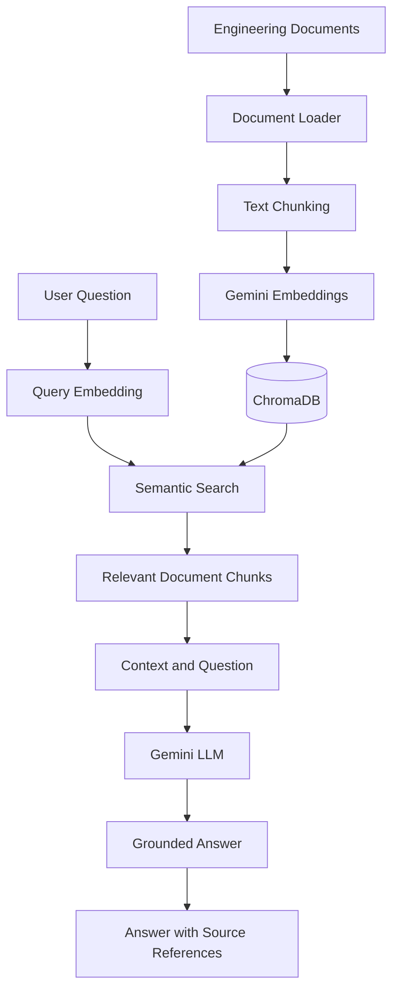

# Engineering Knowledge Assistant

An AI-powered engineering knowledge assistant that uses **Retrieval-Augmented Generation (RAG)** to answer questions from engineering documentation.

The application retrieves relevant information from a curated knowledge base, uses Google's Gemini model to generate grounded answers, and provides references to the original documents.

## Features

- **Retrieval-Augmented Generation (RAG):** Generates answers using retrieved engineering documentation.
- **Document processing:** Supports PDF, TXT, and Markdown documents.
- **Semantic search:** Uses Gemini embeddings to find contextually relevant information.
- **Vector database:** Stores document embeddings and metadata in ChromaDB.
- **Source references:** Displays the documents and page numbers used to generate answers.
- **Grounded responses:** Avoids answering questions when the knowledge base does not contain sufficient information.
- **Interactive UI:** Provides a simple interface built with Streamlit.
- **Read-only public demo:** Uses a curated collection of engineering documents. Public visitors cannot upload or modify documents.

## Technology Stack

| Component | Technology |
|---|---|
| Programming language | Python 3.13 |
| Generative AI | Google Gemini |
| Embeddings | Gemini Embedding API |
| Vector database | ChromaDB |
| Document processing | PyPDF |
| Application interface | Streamlit |
| Configuration | Python Dotenv |
| Version control | Git and GitHub |

## Architecture



## RAG Workflow

1. **Document ingestion:** Loads engineering documents in supported formats.
2. **Text extraction:** Extracts text and relevant metadata from documents.
3. **Chunking:** Splits extracted content into smaller overlapping text chunks.
4. **Embedding generation:** Generates vector embeddings using Gemini.
5. **Vector storage:** Stores embeddings, text, and metadata in ChromaDB.
6. **Semantic retrieval:** Converts the user's question into an embedding and retrieves relevant document chunks.
7. **Answer generation:** Sends the retrieved context and question to Gemini.
8. **Source references:** Displays references to the documents used to generate the answer.

## Project Structure

```text
engineering-knowledge-assistant/
│
├── app/
│   ├── database/
│   │   └── vector_store.py
│   │
│   ├── services/
│   │   ├── document_loader.py
│   │   ├── embedding_service.py
│   │   ├── gemini_service.py
│   │   ├── ingestion_service.py
│   │   ├── knowledge_base_service.py
│   │   ├── rag_service.py
│   │   └── text_chunker.py
│   │
│   ├── ui/
│   │   └── streamlit_app.py
│   │
│   ├── utils/
│   ├── config.py
│   └── main.py
│
├── docs/
│   ├── sample_kafka_notes.md
│   └── sample_kafka_notes.pdf
│
├── tests/
├── .env.example
├── .gitignore
├── requirements.txt
└── README.md
```

## Local Setup

### Prerequisites

- Python 3.13
- Git
- A Google Gemini API key

### 1. Clone the repository

```bash
git clone https://github.com/guptakomalwork18/engineering-knowledge-assistant.git

cd engineering-knowledge-assistant
```

### 2. Create a virtual environment

**Windows PowerShell:**

```powershell
py -3.13 -m venv .venv
```

Activate it:

```powershell
.\.venv\Scripts\Activate.ps1
```

### 3. Install dependencies

```powershell
python -m pip install --upgrade pip

pip install -r requirements.txt
```

### 4. Configure environment variables

Create a `.env` file in the project root using `.env.example` as a reference.

```env
GEMINI_API_KEY=your_gemini_api_key_here
GEMINI_MODEL=gemini-3.5-flash-lite
```

Get an API key from [Google AI Studio](https://aistudio.google.com/apikey).

**Important:** Never commit your `.env` file or expose your API key in source code.

### 5. Run the application

```powershell
python -m streamlit run app/ui/streamlit_app.py
```

Open the local URL displayed in the terminal, usually:

```text
http://localhost:8501
```

The application initializes its curated knowledge base from the sample documents in `docs/`.

## Running Tests and Validation

Compile the application:

```powershell
python -m compileall -q app
```

Check repository whitespace:

```powershell
git diff --check
```

The repository also contains individual diagnostic scripts for document loading, chunking, embeddings, vector storage, semantic retrieval, RAG behavior, and Gemini error handling.

## Deployment

The public demo is intended to be deployed using [Streamlit Community Cloud](https://streamlit.io/cloud).

Deployment overview:

1. Push the project to GitHub.
2. Sign in to Streamlit Community Cloud.
3. Create an application from the GitHub repository.
4. Set the application entry point to:

   `app/ui/streamlit_app.py`

5. Add the following values in the application's secrets configuration:

```toml
GEMINI_API_KEY = "your_gemini_api_key"
GEMINI_MODEL = "gemini-3.5-flash-lite"
```

6. Deploy the application and share the generated public URL.

The application initializes its sample knowledge base from the documents committed to the repository.

## Limitations and Security Considerations

- The public demo uses a fixed, curated knowledge base.
- Document uploads and visitor-managed knowledge bases are not enabled.
- Answers depend on the information available in the indexed documents.
- Gemini API usage is subject to the provider's quotas and rate limits.
- The deployed application may be subject to Streamlit Community Cloud resource and availability limits.
- Do not add confidential or sensitive engineering documents to the public demo.
- Questions and retrieved document context are sent to the Gemini API for answer generation. Review Google's applicable data-use terms before using sensitive information.
- The deployment uses local ChromaDB storage and rebuilds the sample knowledge base when necessary. It is not designed as a durable multi-user database.

## Future Enhancements

- User authentication and private knowledge bases.
- Secure document uploads.
- Persistent cloud vector storage.
- Support for additional document formats.
- Improved request throttling and abuse protection.
- Conversation history and contextual follow-up questions.
- Docker-based deployment.
- Agentic AI capabilities for engineering workflows.

## Author

Developed as a hands-on Generative AI and backend engineering project to explore document processing, embeddings, vector databases, semantic retrieval, and Retrieval-Augmented Generation.
